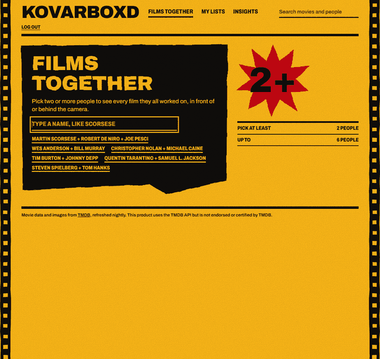
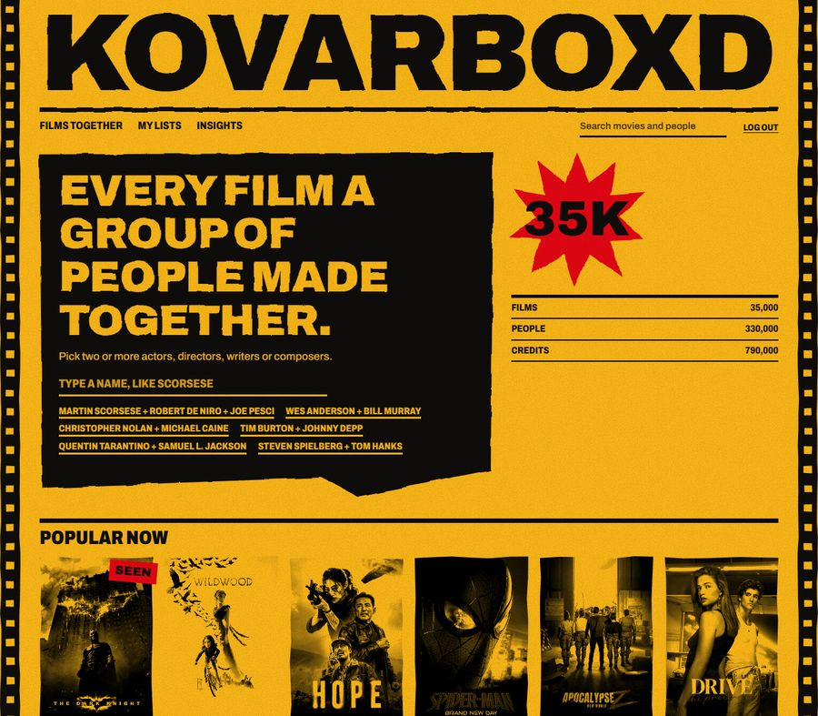
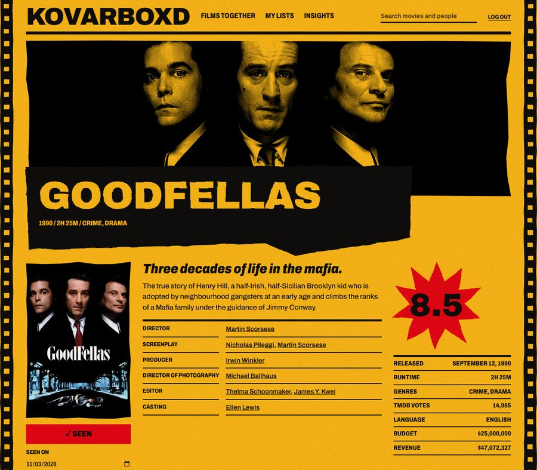
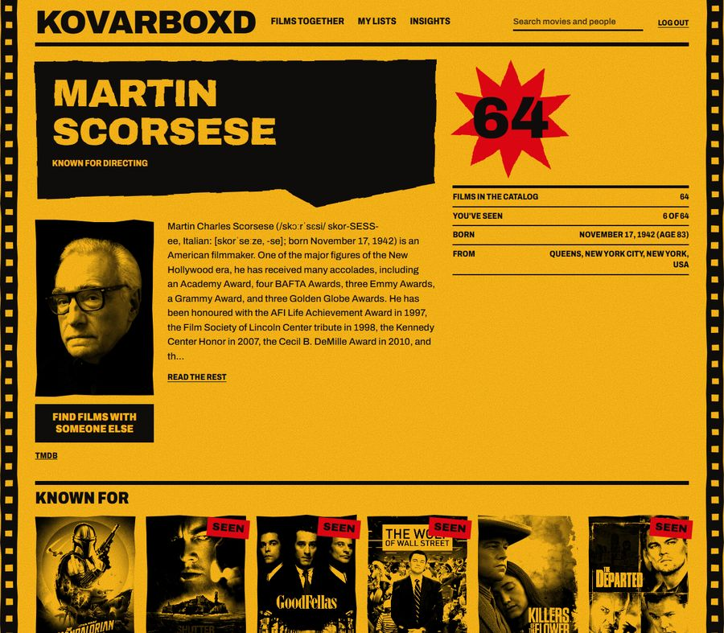
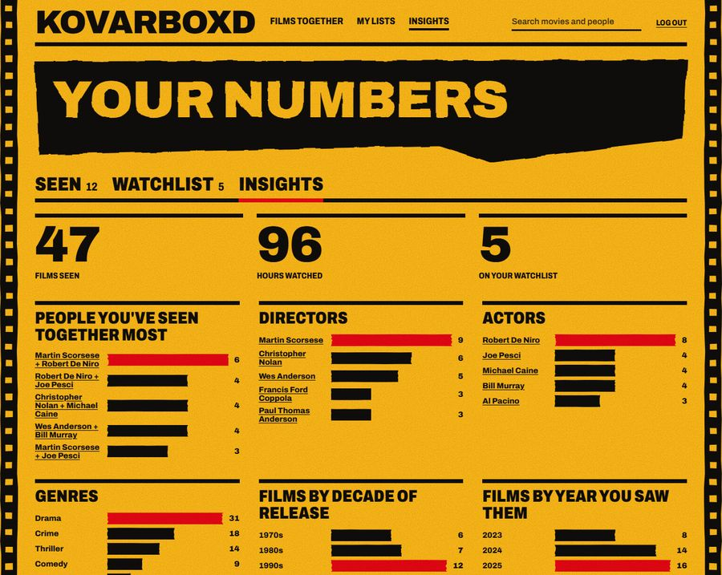

# Kovarboxd

**Every film a group of people made together.** Pick two or more actors,
directors, writers or composers, and Kovarboxd finds every movie they all worked
on, with what each of them did on it.



Live at <https://kovarboxd.vercel.app>. Invite-only.

## What it does

- **Films together:** up to 6 people, cast or crew, newest first, with each person's role on each film. Results have a link you can share. Type `adam driver, scarlet johanson` into search and it offers the same thing, typos and all.
- **Search with typo tolerance:** "kubrik" finds Stanley Kubrick, "godfahter" finds The Godfather, with suggestions as you type.
- **Seen and watchlist:** mark films seen, with an optional date, and keep a watchlist. Films together then shows "You've seen 2 of 4" and can hide what you've seen.
- **Insights:** your films by decade, genres, directors, actors, and the people you've seen together most, each linking back to films together.

| | |
| --- | --- |
|  |  |
|  |  |

The Seen marks and the insights numbers in these screenshots are sample data.

## How it's built

```
TMDb daily export + API
        |
        |  pipeline/ (Python), nightly GitHub Action
        v
Supabase Postgres, kovarboxd schema
35,000 movies, 330,000 people, 790,000 credits, in a 300 MB budget
        |
        |  web/ (Next.js 16 on Vercel), Row-Level Security
        v
Search, films together, movie and person pages, personal lists
```

- **[`pipeline/`](pipeline/README.md):** loads and syncs movies, people and trimmed credits from TMDb. Backfill, nightly sync, data-quality report.
- **[`web/`](web/README.md):** the app. Pages are cached for hours, and only the personal parts render per request.
- **`supabase/migrations/`:** the database schema, search functions and access rules.
- **`legacy/`:** the original Flask app on a 16 GB local copy of IMDb's data, kept for reference. See [its README](legacy/README.md).

A few decisions worth knowing about:

- **A size budget, enforced.** The database shares a free 500 MB plan with another app. The pipeline measures its own size and stops adding movies at 95% of budget.
- **Credits are trimmed.** Top 25 billed cast and key crew jobs keep 38% of TMDb's credits and fit the budget. The trade-off: someone billed 40th won't connect two films.
- **Two popularity cutoffs.** Popularity near the 3.0 backfill cutoff swings 20% a day, so the nightly sync only adds movies at 8 or above. The [pipeline README](pipeline/README.md) has the measurements.
- **A design from film, not from a template.** The yellow and red are sampled from the Kodak logo, the side stripes come from film edges and the suit in *Kill Bill*, and the rough edges come from cut-paper title sequences. Posters print black on yellow in lists and show real color on the movie page.
- **Invite-only in the database.** A trigger on the auth table blocks any signup not on the invite list, and each person's lists are private through Row-Level Security.

## Running it

See [`web/README.md`](web/README.md) for the app and [`pipeline/README.md`](pipeline/README.md) for the data. Checks run on every pull request (`.github/workflows/ci.yml`).

```bash
cd web && npm install && npm run dev
```

```bash
python -m pytest
```

This product uses the TMDB API but is not endorsed or certified by TMDB.
